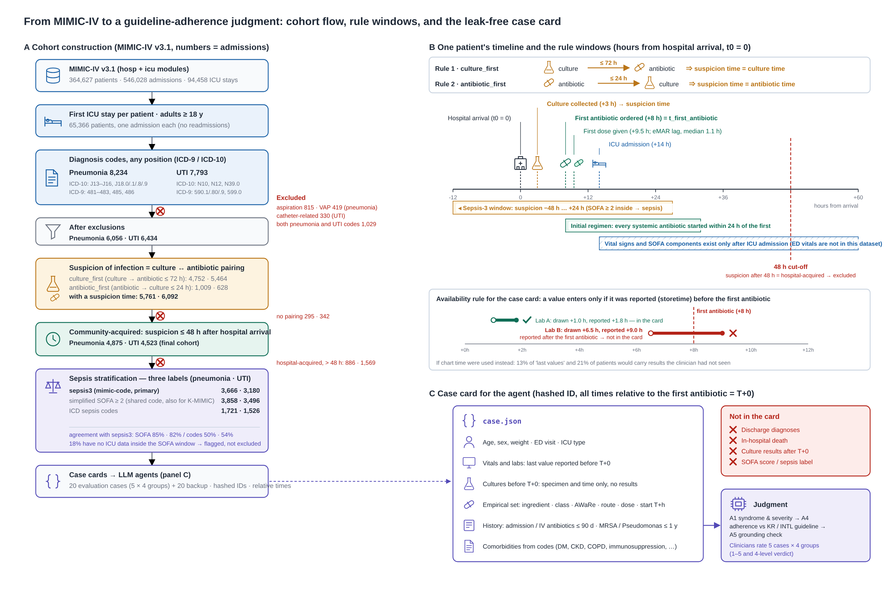
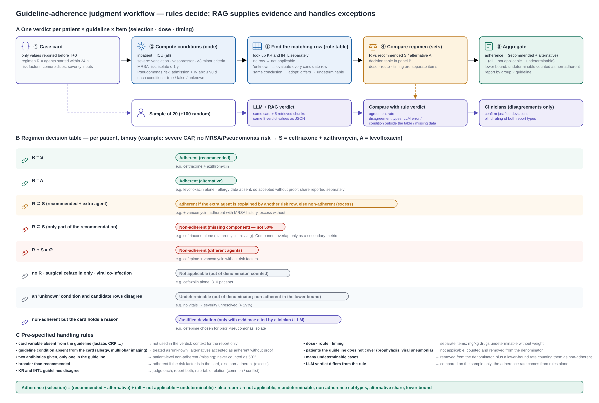

# A Guideline-Informed AI Agent for Empiric Antibiotic Decision Support in the ICU

Korea Clinical Datathon 2026 · Team 5 · MIMIC-IV (US) and K-MIMIC (Korea)

Does the **first empiric antibiotic regimen** given to adult ICU patients with community-acquired **pneumonia** or **urinary tract infection** follow national guidelines, and can an AI agent with retrieval-augmented generation (RAG) make and explain that judgement? Each admission becomes a leakage-free **case card**; a **rule engine** transcribed from the guideline tables judges it; an **LLM + RAG layer** explains the judgement with cited guideline passages. Three clinicians scored the RAG on guideline questions. A clinician review of rule–LLM disagreements on 20 sample cases is planned as the next validation step.

<p align="center"></p>

## Design

| | K-MIMIC (Korea, 7 hospitals) | MIMIC-IV v3.1 (BIDMC, US) |
|---|---|---|
| Guidelines for judgement | KDCA/KSAT CAP (K02) · UTI (K04), 2025 edition | ATS/IDSA CAP 2019 (M03) · IDSA cUTI 2025 (M07) |
| Common yardstick | WHO AWaRe 2025 (W01, W02) | same |
| Sepsis label (stratification only) | ICD sepsis codes | Sepsis-3 (mimic-code) |
| Where the data are processed | inside the KHDP platform; only aggregates leave | locally by a credentialed user |

Korean data are judged against Korean guidelines and US data against US guidelines; there is no cross-judgement, because recommendations encode local resistance epidemiology.

**Cohort.** First ICU stay per patient, adults, pneumonia (J13–J16, J18.0/.1/.8/.9) or UTI (N10, N12, N39.0) codes; aspiration/VAP and catheter-associated infections excluded. Suspected infection = culture→antibiotic within 72 h or antibiotic→culture within 24 h; community-acquired = suspicion within 48 h of hospital arrival. Empiric regimen = all systemic antibiotics started within 24 h of the first antibiotic.

**Case card.** Hashed ID, times relative to the first antibiotic order (T+0), and only values *reported* before T+0 (vitals, labs, specimen types, history, comorbidities, regimen). Discharge diagnoses, death, culture results and the sepsis label are withheld, so the rule engine, the LLM and the clinicians see the same information.

**Judgement.** Set comparison of the regimen against the guideline row that matches the card (severity, MRSA/Pseudomonas risk, sepsis, route): recommended · alternative · missing agent · unexplained extra agent · different agents · justified deviation · not applicable · undeterminable. Unknown conditions are resolved by evaluating every candidate row; if the rows disagree the case is marked undeterminable rather than guessed.

<p align="center"></p>

## Results

**MIMIC-IV (9,398 admissions)**

| | Pneumonia (n = 4,875) | UTI (n = 4,523) |
|---|---|---|
| Sepsis-3 positive | 3,666 (75%) | 3,180 (70%) |
| Adherence to US guidelines (ICU admission treated as severe) | **12.5%** | **39.4%** |
| Sensitivity: severity from card values only | 13.3% | — |
| Sensitivity: anti-MRSA add-on allowed in sepsis (IDSA remark) | — | 56.3% |
| Most frequent non-adherent regimens | cefepime + vancomycin · pip/tazo + vancomycin | pip/tazo + vancomycin · cefepime + vancomycin |
| WHO AWaRe share of regimen components (Access / Watch / Reserve) | 14.1 / 84.9 / 1.0 % | 20.2 / 78.3 / 1.5 % |

Non-adherence is dominated by empiric anti-MRSA and anti-pseudomonal coverage added to the standard β-lactam ± macrolide regimen. Full tables: [`mimic/results/summary.md`](mimic/results/summary.md), [`aware_table.md`](mimic/results/aware_table.md), [`guideline/rule_judge/`](guideline/rule_judge/).

**K-MIMIC (7 hospitals; pneumonia 12,062 · UTI 2,895 admissions)**

Numbers are from the team presentation (`docs/`). Most frequent antibiotics in pneumonia (share of prescriptions): piperacillin/tazobactam 20.0%, meropenem 12.8%, levofloxacin 9.4%, TMP-SMX 6.7%, ceftriaxone 4.9%, vancomycin 4.5%, teicoplanin 4.2%. In these hospitals teicoplanin is used alongside vancomycin, so glycopeptides are pooled in class comparisons. Guideline adherence on K-MIMIC is computed inside the KHDP platform with the kit in [`kmimic/`](kmimic/); patient-level files never leave the platform.

**RAG (7 guideline PDFs, BGE-M3 + FAISS, 9 retrieved chunks).** Two local generators were compared on 21 guideline questions with identical retrieval. The Korean medical model HARI-q3-8B scored higher than Qwen3.5-9B on all automatic metrics (cosine 0.747 vs 0.711, BERTScore 0.884 vs 0.879) and in clinician scoring (3 raters × 5 criteria, 1–5): 3.61 vs 3.33. Groundedness (citation accuracy) was the weakest criterion for both.

**Agent.** Designed with three functions (adherence report, guideline-based recommendation, similar-case prescriptions); the adherence report is implemented as an app on khdp.ai ([`app/`](app/)): rule judgement, BM25 guideline retrieval with file/line citations, a dashboard built from the aggregate files, and an LLM judgement loop that compares the model's eight-value JSON verdict with the rule engine. The app runtime has no LLM endpoint, so the LLM step is run manually: the app composes the prompt, the user submits it to the platform chat and pastes the JSON verdict back. Demo video: [`app/Demo_version.mp4`](app/Demo_version.mp4).

## Repository

```
mimic/       MIMIC-IV extraction (standard-library Python, ~7 min), notebook builder, aggregate results
kmimic/      K-MIMIC kit for the KHDP platform: 3 standalone SQL queries, runner, derive → cards → judge → AWaRe
guideline/   rule engines (rule_judge_kr.py, rule_judge_intl.py), RAG query builder, verdict comparison, 8 synthetic demo cards
figures/     pipeline and judgement figures (PNG + SVG)
app/         app build request and in-app LLM prompt (khdp.ai Apps)
docs/        presentation deck (PDF, PPTX)
```

Run order (MIMIC): `mimic/code/extract_mimic_cohort.py --mimic <mimic-iv-3.1 dir> --out mimic/data` → `mimic/code/build_notebook.py` → `mimic/code/make_final_cards.py` (case cards) → `guideline/rule_judge/rule_judge_intl.py --icu-severe cards_all.jsonl verdicts.jsonl` → `kmimic/aware_table.py cards.jsonl`. Run order (K-MIMIC): [`kmimic/KMIMIC_EXTRACTION.md`](kmimic/KMIMIC_EXTRACTION.md). Everything is standard-library Python. The smoke test in `kmimic/test_data/` (3 synthetic patients) and the 8 synthetic cards in `guideline/rag_match/demo/` run without real data.

## Data and licensing

- **No patient-level data are in this repository.** MIMIC-IV derivatives (extracted CSVs, case cards, verdict files, notebook outputs) are available only to PhysioNet-credentialed users. K-MIMIC data stay inside the KHDP platform.
- **Guideline PDFs and their text are not redistributed**, except the WHO AWaRe documents (CC BY-NC-SA 3.0 IGO). Obtain the Korean and US guidelines from the issuers (KDCA/KSAT, ATS/IDSA, IDSA) and run `pdftotext -layout` to the file names expected in `guideline/text/`; the rule engines cite table and line positions of those files. The RAG vector store in `guideline/vectorstore/` keeps embeddings and page references for every guideline but chunk text only for the WHO documents (see its README).
- Clinician evaluation sheets are private; scores are reported in aggregate.
- The WHO AWaRe mapping in `kmimic/aware_2025.csv` follows the 2025 WHO list, with route-dependent entries for fosfomycin and minocycline.

## Team

Minso Kim, Soyoung Park, Taewon Jung, Jisu Ha, Seungmin Lee, Woojin Kim. Korea Clinical Datathon 2026, Pyeongchang, 16–17 October 2026.
